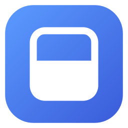
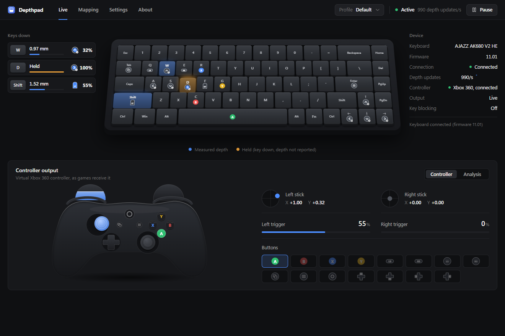
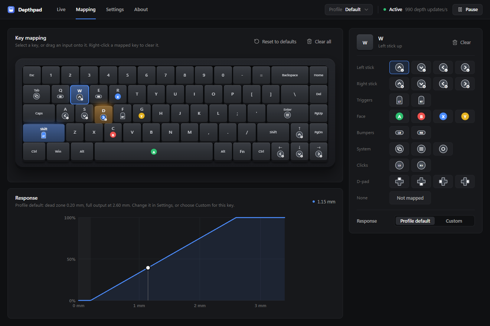
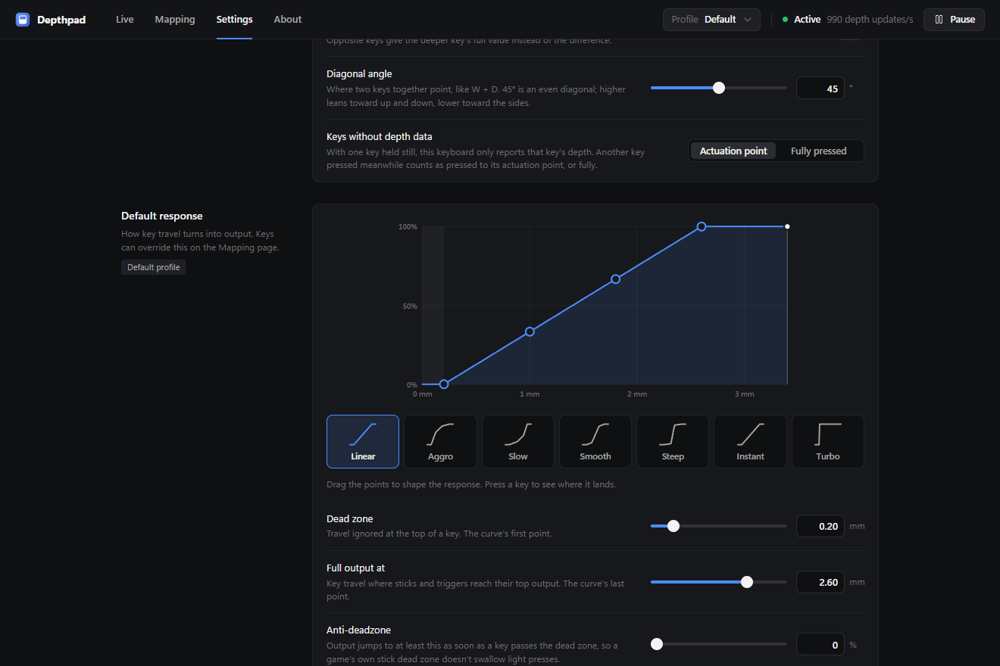

<h1 align="center">Depthpad</h1>

Turn a Hall-effect keyboard into an analog game controller. 
How far you press a key becomes how far the stick moves or the trigger pulls.

## What it does

- **Analog movement from your keys.** Press W lightly to walk, fully to run. Ease into the throttle and brake in racing games.
- **Works in any game that supports a controller.** Depthpad creates a virtual Xbox 360 or PlayStation (DualShock 4) controller.
- **Map any key** to any stick direction, trigger or button by dragging, with a live view of what the game receives.
- **Shape the response** with a draggable curve, presets (Linear, Aggro, Slow, Smooth, Steep, Instant, Turbo) and an anti-deadzone.
- **Profiles** with hotkeys to switch between them, an on-screen badge and sound when you do, and **app linking** that picks a profile when a game is in front.
- **Optional key blocking**, so games see only the controller. Right Ctrl + P pauses everything so you can type.
- **Light on resources.** Closed to the tray it uses about 6 MB of memory and 1% of one CPU core.

  
  

## Install

1. Download `Depthpad_x.y.z_x64-setup.exe` from [Releases](https://github.com/VanshajR/depthpad/releases).
2. Run it. If the ViGEmBus controller driver is missing, the installer offers to add it (Windows asks for permission).
3. Connect the keyboard **with the USB cable**. Analog data isn't sent over wireless.

> Windows may say "Windows protected your PC", because Depthpad isn't code-signed yet. Choose **More info → Run anyway**. Each release lists SHA-256 checksums so you can check your download.

Requires Windows 10 or 11 (64-bit). Depthpad checks for new versions at start-up and updates itself when you click **Update and restart** (you can turn the check off in Settings).

## Keyboards

<!-- keyboards:start (generated) -->
Depthpad supports **269 keyboards from 95 brands**; the full list, model by model, is in
[docs/KEYBOARDS.md](docs/KEYBOARDS.md).

| Brand | Boards |
|---|---|
| Attack Shark | Beat75, K85 + K85 Pro HE, R68 HE + X68 HE, R82 HE + R82 Pro HE, R85 HE + R85 Ultra and 13 more |
| AJAZZ | **AK680 V2 HE (tested)**, AK680 MAX HE, AK680MC, AK820 MAX HE (Sonix revision, 0C45:80B1), AK820 MAX HE (wired RGB, 0416:7372) and 6 more |
| ATK | 68 V2 Pro, 68 V3 + RS6+ + RS6 Ultra+ + RS6 Cube + 68 RX, EDGE 60 HE + 60 RX, EDGE 63 HE + RS63 Air, EDGE 75 HE and 6 more |
| FL ESPORTS | Blend HE, D75 HE, D98 HE, FL750 (magnetic version), Flame65S and 6 more |
| EPOMAKER | G84 HE JIS, HE108, HE60 Lite, HE60 Wired, HE60 Wireless and 5 more |
| EWEADN | DEEP68 HE, DEEP80 HE (magnetic version), DEEP80 Pro HE (magnetic version), SEEK75, SMART 875 HE and 5 more |
| AULA | HERO 68 HE PRO, KP-TE153, MINI 60 HE, MINI 60 HE MAX, MINI 60 HE PRO and 4 more |
| Valkyrie | VK 99 Gaming (Naruto), VK Mag68, VK Mag68 Max, VK Mag75, VK Mag75 Lite and 4 more |
| IROK | Mercury68, Mercury68 Pro, MG75 Max, MG75 Pro, NA87 and 3 more |
| Keychron | K2 HE, K4 HE, K6 HE, Q1 HE, Q2 HE and 3 more |
| Redragon | K617 HE, K673 HE (BR), K673 HE (UK), K673 HE (US), K686 HE (BR) and 3 more |
| DrunkDeer | A75, A75 ISO, A75 Pro, G60, G65 and 2 more |
| MonsGeek | FUN60 Pro, FUN60 Ultra TMR, FUN68 HE, FUN75, M1 V5 TMR and 2 more |
| Keydous | NJ68 Pro-CP, NJ80-CP V3 HE, NJ81-CP, NJ81-CP V3 HE, NJ98-CP and 1 more |
| Xinmeng | Beat65, Beat68, Beat75, X87 TMR, X98 V3 (magnetic version) and 1 more |
| Akko | MOD 007 V5 HE, MOD007B V3 HE, MOD007S V3 HE, Ray68 HE, TAC75 HE |
| Razer | Huntsman Mini Analog, Huntsman V2 Analog, Huntsman V3 Pro, Huntsman V3 Pro Mini, Huntsman V3 Pro Tenkeyless |
| GamaKay | NS68, NS75, TK75 HE, TK75 TMR |
| HATOR | Skyfall 65 MAG Ultima 8K Wireless, Skyfall 65 MAG Ultra 8K, Skyfall 80 MAG Ultima 8K Wireless, Skyfall 80 MAG Ultra 8K |
| IPI | Aurora75 PRO, flash68, QBZ65 + AURORA65 + AURORA65W + RAIN65, QBZ75 + Aurora 75 |
| JINGSU | KA67, KB98, KCC04A, KE87 |

Also: AIM1, ANGRYSHARK, ANTGAMER, ARDOR GAMING, ASTROMEDA, ATWO, Blackstorm, BOYI, CHERRY XTRFY, COLORFUL, DARKFORCE, DSPIXEL, E7, EDRA, Everglide, EvoFox, FREEWOLF, Fuego, Funbey, Fury, G TUNE, Game Arena, GAMEBOOSTER, GAMEPOWER, GamePro, GravaStar, HAVIT, HAWK Gaming, IDEEZ, IDJ, IYX, JEDEL, KiiBOOM, Koda, KYSONA, Lemokey, LinkerFoo, LOMZ, M4G, MadLions, MageGee, MAMBASNAKE, MechLands, MEETION, MICROPACK, MSI, Ninjadog, NOS, Nova Gaming, NuPhy, Nyfter, Oniverse, OUSAID, PIIFOX, PSYCommu, Rampage, Royal Kludge, ROYALAXE, SALPIDO, SARU, SAVIO, SayoDevice, Skyloong, SteelSeries, Sunsonny, Syntech, Titan Nation, UluGames, URX, Veekos, WLMOUSE, Womier, Wooting, YUNZII.
<!-- keyboards:end -->

Only the AJAZZ AK680 V2 HE has been tested with Depthpad so far. Everything else is written from working code in [HallJoy](https://github.com/PashOK7/HallJoy) and [AnalogSense](https://github.com/AnalogSense/JavaScript-SDK), but nobody has tried it with Depthpad yet. Boards sold under many brands (RongYuan, SparkPlayJoy, iLLumiPC firmware) are recognised by what their firmware reports, and Depthpad then draws that exact model. If you own one, please try it and [tell us how it went](https://github.com/VanshajR/depthpad/issues/new?template=keyboard-support.yml).

**Your keyboard isn't listed?** Open Depthpad → Settings → Keyboard → **Create report** (or run `depthpad-probe.exe` from the release). It records what your keyboard sends during a few guided key presses, without changing anything on it, and saves a file to attach to a [keyboard support request](https://github.com/VanshajR/depthpad/issues/new?template=keyboard-support.yml). See [docs/KEYBOARD_REPORTS.md](docs/KEYBOARD_REPORTS.md).

## Good to know

- **AJAZZ AK680: one key at a time is fully analog.** The keyboard only reports the depth of the key that moved last. Hold W still and press D, and D can't be measured, so it counts as pressed to its actuation point (shown amber). Moving both keys keeps both analog.
- **Key blocking affects every keyboard.** Windows doesn't say which keyboard a key came from.
- **The switch badge needs windowed or borderless games.** Nothing can draw over exclusive fullscreen without hooking the game. The sound cue works everywhere.
- **Games running as administrator** hide their keys from normal apps. If hotkeys or blocking stop working in one, run Depthpad as administrator too.
- **Anti-cheat.** Virtual controllers are widely used (Steam Input and DS4Windows work the same way), but check a competitive game's rules before using one.

## How it works

Depthpad reads each key's travel from the keyboard over USB, combines it with the keyboard's normal key events, shapes it with your profile, and sends the result to a virtual controller through [ViGEmBus](https://github.com/nefarius/ViGEmBus). The AK680 protocol notes are in [docs/PROTOCOL.md](docs/PROTOCOL.md).

Built with Rust (the engine and drivers) and [Tauri](https://tauri.app) with [Svelte](https://svelte.dev) (the window).

## Contributing

Contributions are welcome, especially support for more keyboards. Start with [CONTRIBUTING.md](CONTRIBUTING.md); adding a keyboard is described in [docs/ADDING_A_KEYBOARD.md](docs/ADDING_A_KEYBOARD.md), and building in [docs/BUILDING.md](docs/BUILDING.md).

## Credits

- [HallJoy](https://github.com/PashOK7/HallJoy) by PashOK7: stick behaviour, key-blocking rules, keyboard session handling, and most of the keyboard support: its analog protocols, key maps, layouts and model identification (AGPL-3.0).
- [AnalogSense](https://github.com/AnalogSense/JavaScript-SDK) by Calamity, Inc.: analog protocols for Wooting, Razer, NuPhy, DrunkDeer, Keychron, Lemokey, MadLions and Redragon boards (MIT).
- [ViGEmBus](https://github.com/nefarius/ViGEmBus) by Nefarius Software Solutions: the virtual controller driver.

## Licence

GNU AGPL-3.0. See [LICENSE](LICENSE) and [THIRD_PARTY_NOTICES.md](THIRD_PARTY_NOTICES.md). Depthpad is not affiliated with AJAZZ, Wooting, Razer, NuPhy, DrunkDeer, Keychron, Lemokey, MadLions, Redragon or Microsoft.
